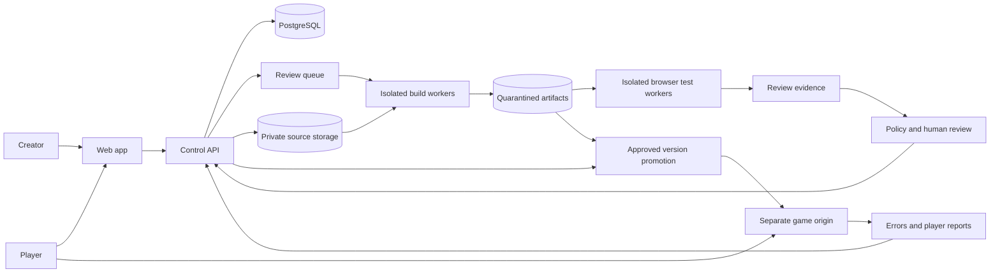

# PlayDock

**The launch dock for AI-native games.**

Build with AI. Publish with confidence. Discover something worth playing.

[中文介绍](README.zh-CN.md) · [Architecture](docs/architecture.md) · [4-week roadmap](docs/roadmap.md) · [Game manifest example](examples/game.manifest.json)

## The idea

AI can turn a prompt into a game, but a generated prototype still needs a home: somewhere to test it, publish it, find players, and earn revenue. PlayDock is a planned platform where creators can bring AI-generated browser games, keep them private, share them publicly, or eventually sell access.

The core product is a **review-to-publish workflow**: isolated builds, automated playability checks, actionable review reports, and a curated discovery surface. Passing a build alone does not make a game fun; human playtesting and player feedback remain part of the process.

## Current status

**Planning / pre-MVP.** This repository contains the product and technical blueprint. There is no running platform, implemented sandbox, payment service, or measured performance result yet. The four-week schedule below starts at development kickoff; it is a target, not a completed delivery claim.

We plan to build the MVP with **Devin Bots**, using bounded implementation tasks with acceptance criteria and human-reviewed pull requests. This is an independent project, with no claim of affiliation, sponsorship, or approved credits from Cognition.

## MVP scope

- **Browser games first:** HTML5 / JavaScript / WebGL games that build into static assets. No uploaded server processes in the first release.
- **Bring your own game:** upload source generated with any AI coding tool; in-platform game generation is a later phase.
- **Private and shared publishing:** private previews require authorization; public listings require technical checks and a human playability review.
- **Creator dashboard:** upload versions, inspect review evidence, fix failures, and promote approved releases.
- **Discovery:** browse approved games, rate them, report issues, and view a basic leaderboard with minimum sample requirements.
- **Paid access prototype:** test-mode checkout, access entitlements, and a creator revenue ledger. Real payments and payouts come after the relevant operational requirements are ready.

## Proposed architecture



Proposed stack: TypeScript, Next.js, Fastify, PostgreSQL, Redis/BullMQ, S3-compatible object storage, and Playwright. Build and browser workers run away from the control plane in disposable, restricted environments. **An ordinary Docker container alone is not considered a sufficient boundary for hostile uploads.** The worker isolation technology must pass the week-one threat-model review before accepting external code.

See [architecture and trust boundaries](docs/architecture.md) for the proposed modules, lifecycle, API, and runtime controls.

## How a game reaches the public catalog

1. **Validate the submission.** Check the manifest, archive paths, size limits, license/source declarations, and supported build format.
2. **Scan the source.** Detect exposed secrets, known vulnerable dependencies, suspicious scripts, and disallowed capabilities. Findings produce evidence, not a claim of complete malware detection.
3. **Build in isolation.** Use a pinned toolchain and lockfile, enforce resource limits, and allow dependency downloads only through a controlled registry path.
4. **Run automated checks.** Execute available unit tests and a browser smoke scenario: load → start → interact for three minutes → restart. Capture screenshots, console errors, network attempts, and performance data. A creator-supplied scenario is supplemented by platform-owned probes.
5. **Review content and playability.** Automated content checks assist a human reviewer. Reviewers assess the actual game loop, asset declarations, and obvious misleading behavior. Paid and featured releases receive additional review.
6. **Publish an exact version.** Approval is bound to the artifact digest. Any code update creates a new version and review; public hosting serves the approved artifact only.
7. **Monitor and recover.** Track load failures, uncaught errors, reports, and regressions. Suspend a release or restore an earlier approved version when evidence warrants it.

Private games still pass the baseline security checks. They are not a bypass for unsafe execution. AI-generated tests are advisory: they cannot certify safety, ownership, or fun.

## Four-week delivery plan

| Week | Deliverable | Demonstrable acceptance evidence |
| --- | --- | --- |
| 1 | Upload contract, version model, threat model, isolated build spike | A sample game produces a versioned artifact and report; invalid archives and resource overruns are rejected |
| 2 | Review runner, browser smoke tests, evidence storage, review states | A playable fixture passes; broken-entry, crash, and prohibited-network fixtures are blocked with reports |
| 3 | Creator dashboard, private/shared release flow, test-mode paid access | An authorized user plays a private release; an unauthorized user is denied; test purchases grant access idempotently |
| 4 | Catalog, ratings, leaderboard, monitoring, ten seed games | Ten seed games are reviewed; a bad release is suspended and rolled back; a demo and known-limitations report are published |

Detailed task breakdown and release gates: [docs/roadmap.md](docs/roadmap.md).

## Business model to validate

The first commercial hypothesis is a **20% platform commission / 80% creator share**, with the final treatment of fees, taxes, and refunds specified before launch. A creator Pro plan could add storage, analytics, and larger private-project quotas. Pricing requires customer validation; paid tiers will not bypass review or buy organic ranking.

Generation credits, player subscriptions, and enterprise hosting are later experiments. They are outside the four-week MVP.

## What success would look like

- Ten seed games with reproducible builds and review evidence at the end of the sprint.
- A target of under ten minutes for the automated review stages on the supported small-game benchmark; queue time and human review time reported separately.
- A target of fewer than 1% observed sessions with load failures or uncaught errors, reported with sample size and telemetry limitations. This is not a current measured result or SLA.
- A first-month experiment after public launch: twenty approved games and three games with a real purchase, once real payments are enabled.

## Repository map

```text
README.md                    English project pitch and delivery plan
README.zh-CN.md               Chinese project pitch
docs/architecture.md         Proposed architecture and review contract
docs/roadmap.md               Four-week tasks and acceptance gates
examples/game.manifest.json  Illustrative upload manifest (not a working game)
.gitignore                   Local files and credentials excluded from Git
```

There is no install or run command yet. The next concrete step is week one's upload contract and isolated build spike. Contributors can use GitHub Issues to propose a seed game, discuss the review workflow, or help implement a roadmap item.
