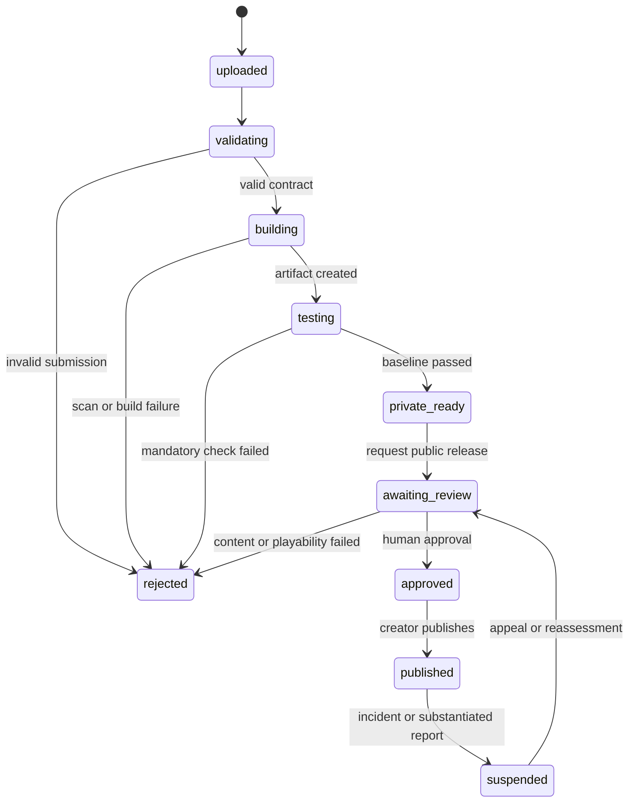

# Proposed architecture

Status: design proposal. All components and endpoints below are planned, not implemented.

## Scope and boundaries

The first supported format is a browser game compiled to static assets. Uploaded server code, arbitrary persistent processes, multiplayer backends, and runtime AI API calls are outside the MVP. Games run in the player's browser, with a separate automated execution environment used during review.

Visibility and monetization are separate fields: `private` or `public`, and `free` or `paid`. Paid access is prototyped in payment-provider test mode first. A public listing can describe a paid game without exposing its protected assets.

## Planned modules

| Module | Responsibility | Proposed implementation |
| --- | --- | --- |
| Web | Creator dashboard, catalog, player shell | Next.js / TypeScript |
| API | Authentication, authorization, games, versions, reviews, entitlements | Fastify / TypeScript |
| Database | Relational metadata, review decisions, audit events, revenue ledger | PostgreSQL |
| Queue | Review orchestration, retries, cancellation, concurrency limits | Redis / BullMQ |
| Storage | Private source archives, immutable artifacts, review evidence | S3-compatible storage |
| Build worker | Archive validation, dependency install, build, artifact hashing | Disposable isolated guest; technology chosen during week-one spike |
| Test worker | Independent browser probes and supported gameplay scenarios | Playwright in a separate disposable isolated guest |
| Delivery | Authorized asset delivery and isolated player origin | Separate registrable domain, release-scoped routing |

Suggested implementation layout once development begins:

```text
apps/web/
apps/api/
workers/build/
workers/review/
packages/contracts/
packages/game-sdk/
infra/
tests/fixtures/
```

These directories are proposed; empty application scaffolding is intentionally not presented as implemented software.

## Submission contract

[game.manifest.json](../examples/game.manifest.json) illustrates the proposed contract. The first implementation task is to define its JSON Schema and server-side validation together.

- Require a schema version, game slug, title, build command, output directory, entry path, and supported runtime.
- Paths must be relative, normalized, and confined to the project or artifact root. Reject traversal, escaping symlinks, oversized archives, and decompression bombs before execution.
- Source uploads must include a supported package manifest and lockfile. Pin the runtime and build image on the platform side.
- Build commands, package lifecycle scripts, manifests, uploaded tests, and scenario files are all untrusted input.
- Resource values in the manifest are requests. Platform ceilings always override them.
- Default runtime network policy is deny. The first release does not accept arbitrary external destinations.
- Require creator declarations of AI tool use, code license, and asset provenance. A declaration is evidence to review, not proof of ownership.
- The example scenario uses DOM selectors; canvas games need a supported pointer/keyboard scenario and manual review. No arbitrary automation JavaScript is accepted as a trusted test.

## Review lifecycle



Revisions create new immutable version records and restart validation. Review decisions record the source digest, artifact digest, policy version, tool versions, evidence links, and reviewer. Only the artifact digest approved for the requested visibility may be promoted. A failed optional check can request human attention; a failed mandatory check cannot be waived by an AI agent.

Jobs must be idempotent, have bounded retries and wall-clock timeouts, and support cancellation. Infrastructure failure is recorded separately from game failure. Workers receive scoped job credentials, never database administrator credentials or payment secrets.

## Isolation and hosting

### Build and test infrastructure

- Execute untrusted workloads on dedicated worker infrastructure, outside the API and database trust boundary.
- Evaluate a microVM-backed worker or a hardened sandbox runtime during the first week. Until that boundary is validated, accept only maintainer-controlled fixtures.
- Use a non-root guest, restricted capabilities, immutable base images, ephemeral writable storage, and CPU / memory / process / disk / wall-clock limits.
- Do not mount host directories, a Docker socket, personal credentials, or cloud metadata endpoints into jobs.
- Allow dependency installation through a controlled registry proxy; block private network ranges, metadata services, and general outbound access. Gameplay tests deny external traffic by default.
- Treat browser execution as hostile too. The browser runner must not share secrets or a trusted host session with the uploaded game.
- Destroy each job environment and keep only validated artifacts and sanitized evidence.

### Player runtime

- Host game content on a separate registrable domain from the platform, with no shared authentication cookies.
- Embed games with restrictive iframe sandbox flags, Permissions Policy, and a platform-set CSP. For a minimal game, allow scripts but omit same-origin, top-navigation, popups, downloads, forms, and device permissions.
- Validate whether WebGL / module loading / asset CORS work under the chosen opaque-origin policy; document supported packaging constraints before widening capabilities.
- Authenticate private and paid asset requests through short-lived, release-scoped access. Apply the check to all protected assets, not only the catalog or entry page; prevent public CDN caching of those responses.
- Treat browser-delivered paid assets as copyable. Access control is not DRM.
- For the proposed SDK, accept only a small, versioned message set such as `ready`, `session_end`, and `error`. Check iframe window identity, a session nonce, message schema, size, and rate. An opaque-origin iframe's origin may be `null`, so origin text alone is not an authorization check.
- Browser-reported scores and telemetry are untrusted. Do not use them for payouts or competitive prize rankings in the MVP.

## Playability and content policy

Mandatory checks include a valid entry, successful asset loading, bounded resource use, no prohibited network attempts, and a reproducible start/restart scenario. Platform-owned probes supplement uploaded scenarios to reduce self-certification.

Unit tests verify meaningful platform behavior: access control, state transitions, digest binding, archive containment, and payment webhook idempotency. A universal creator-code coverage percentage is not an admission rule: coverage alone does not establish playability or safety.

Human reviewers play every initial public seed game. They verify a comprehensible objective, a working interaction loop, basic controls, and no obvious broken state. Automated text/image moderation assists review; it cannot establish copyright ownership. Keep a report, appeal, and takedown process. Private releases still meet baseline security and prohibited-content rules.

## Core data and API sketch

Entities: `User`, `Game`, `GameVersion`, `Artifact`, `ReviewJob`, `ReviewDecision`, `Release`, `Rating`, `Report`, `Order`, `Entitlement`, and `LedgerEntry`.

| Proposed endpoint | Purpose |
| --- | --- |
| `POST /v1/games` | Create a creator-owned game |
| `POST /v1/games/:id/versions` | Initiate a bounded source upload |
| `POST /v1/versions/:id/submit` | Finalize upload and enqueue validation |
| `GET /v1/versions/:id/review` | Fetch authorized review status and evidence |
| `POST /v1/versions/:id/publish` | Publish an approved version for the requested visibility |
| `POST /v1/releases/:id/play-session` | Authorize play and issue short-lived scoped access |
| `POST /v1/games/:id/reports` | Report a content or runtime problem |
| `POST /v1/billing/webhook` | Verify provider signatures and apply idempotent ledger / entitlement updates |

Authorization is required on every creator/private-resource endpoint; source uploads never become public automatically. Provider callbacks, not browser redirects, determine purchase success. Refunds and disputes update both ledger and entitlement state according to a documented policy.

## Discovery and observability

Initially rank community ratings using a Bayesian average and a minimum sample count, with one rating per authenticated account and rate limits. Label new games separately. Publish the ranking rule; exclude sponsored placement from the organic list. This reduces obvious manipulation but does not eliminate fake accounts.

Track queue duration, build/test duration, failure reasons, artifact sizes, and worker resource use. Player telemetry is minimized and excludes chat, secrets, and raw personal content. Sanitize creator logs before displaying them.

Define observed failure rate as observed sessions with a failed load or uncaught exception divided by observed sessions started, within a stated window. Report sample size and missing telemetry. A provisional incident rule is more than 2% observed failures across at least 100 sessions in an hour; route to investigation and possible suspension. Severe security or content findings can trigger immediate suspension regardless of traffic. Validate thresholds against seed-game data before automating them.

## Devin Bots implementation approach

Use Devin Bots to implement bounded work items: upload validation, queue orchestration, review fixtures, dashboard flows, and payment test-mode integration. Each task includes expected files, failure cases, and evidence required in its pull request. Maintainers review code and run platform-owned checks before merging.

The MVP does not depend on an assumed Devin API or automatically invoke Devin on every uploaded game. If a supported integration is available later, generated tests can be an optional review aid. Do not grant agents production secrets or permission to approve and publish arbitrary uploaded code.
